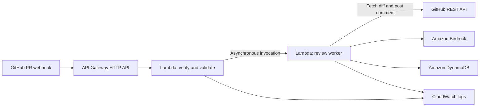

# AI GitHub Code Review & Security Auditor

A Python and AWS coursework/portfolio project that will review GitHub Pull
Request diffs with Amazon Bedrock and post a concise comment containing possible
bugs, security issues, and suggested fixes.

**Current status: stage 1, local foundation.** Webhook validation and the AI
response contract work locally. GitHub API calls, Bedrock inference, DynamoDB,
comment posting, and AWS infrastructure are not implemented yet. Nothing has
been deployed or verified against live services.

## Implementation stages

1. **Local foundation (implemented):** authenticated webhook handling, event
   filtering, PR identifier validation, structured finding validation, and tests.
2. **Review workflow (next):** bounded GitHub diff retrieval, configurable
   Bedrock inference with boto3, DynamoDB duplicate prevention and persistence,
   and one PR comment. Mock every external service in unit tests.
3. **Deployment:** AWS SAM configuration, scoped IAM policies, and an approved
   deployment followed by an explicitly approved live smoke test.

## Architecture

Planned MVP:



The intake Lambda must respond quickly. GitHub expects a response within
[10 seconds](https://docs.github.com/en/webhooks/using-webhooks/best-practices-for-using-webhooks).
The planned second Lambda will do the slower review using
[Lambda's asynchronous invocation](https://docs.aws.amazon.com/lambda/latest/dg/invocation-async.html),
without adding a separate queue service. The intake will acknowledge a review
only after AWS accepts that invocation. Both functions can use the same Python
package with different handlers.

Stage 1 implements the intake validation code, without the worker dispatch, plus
a standalone findings parser. It has no server process or AWS SDK dependency.

## Files

```text
.env.example                 Placeholder configuration; never real credentials
.gitignore                   Excludes local secrets and generated files
src/auditor/
    __init__.py
    handler.py               HTTP API v2 Lambda entry point and safe errors
    webhook.py               HMAC verification and validated PR identity
    findings.py              Strict AI JSON and location validation
tests/
    __init__.py
    helpers.py               Fake webhook fixtures and signatures
    test_handler.py
    test_webhook.py
    test_findings.py
```

## Prerequisites and local testing

Python 3.12 or newer is sufficient for this stage. No packages, AWS account,
GitHub token, Docker, or cloud resources are needed to run the tests.

From the project directory:

```bash
PYTHONPATH=src python3 -m unittest discover -s tests -v
```

Tests use fake webhook data and model responses. Handler failures are injected
with `unittest.mock`; there are no AWS or GitHub clients in this stage. Coverage
includes GitHub's published HMAC test vector, modified payloads, base64/UTF-8,
event filtering, invalid identities, size limits, malformed AI output, invented
locations, configuration failures, and safe logging. Cloud service failure
tests will accompany those clients in stage 2.

## Configuration and credentials

The example file documents variables; the application does **not** load `.env`
files automatically. Unit tests set fake configuration themselves.

| Variable | Purpose | Stage |
| --- | --- | --- |
| `GITHUB_WEBHOOK_SECRET` | Random shared secret used to verify GitHub HMAC signatures | Required by handler now |
| `GITHUB_REPOSITORY` | Exact allowed target repository, `owner/name` | Required by handler now |
| `AWS_REGION` | Chosen AWS region; supplied automatically inside Lambda | Planned |
| `BEDROCK_MODEL_ID` | Available model or inference profile ID; no default assumption | Planned |
| `GITHUB_TOKEN` | Token restricted to the repository being reviewed | Planned |
| `DYNAMODB_TABLE_NAME` | Deployed review table | Planned |

For a local handler experiment in Bash, enter the secret without displaying it
or placing its value in shell history:

```bash
read -r -s -p 'Webhook secret: ' GITHUB_WEBHOOK_SECRET
printf '\n'
export GITHUB_WEBHOOK_SECRET
export GITHUB_REPOSITORY='OWNER/REPOSITORY'
```

Replace the repository placeholder with your target. Use a password manager to
generate and retain a random secret before configuring a real webhook. Never
paste credentials into chat, commit them, or put them in example files.

For deployment, use an AWS CLI profile configured on your machine, preferably
with temporary credentials. Lambda will obtain AWS credentials from its IAM
execution role. It does not need access keys in its environment.

The initial MVP can use Lambda environment configuration for the webhook secret
and GitHub token. Lambda
[encrypts environment variables at rest](https://docs.aws.amazon.com/lambda/latest/dg/configuration-envvars.html);
restrict who can read or edit function configuration. Enter secrets through
Lambda's configuration console after the approved deployment, rather than
embedding values in source files or SAM configuration. A secret store can be
considered later if needed.

For GitHub, plan a fine-grained token restricted to the target repository with
**Pull requests: read and write**. That permission supports reading PR data and
[creating a PR conversation comment](https://docs.github.com/en/rest/issues/comments#create-an-issue-comment).
Do not request broad `repo` or administration permissions. The administrator
configures the webhook manually; the application token does not create it.

## Webhook behavior in stage 1

The handler is `auditor.handler.lambda_handler`, with `src/` as the future Lambda
code root. It expects API Gateway **HTTP API payload format 2.0**, using POST and
GitHub's `application/json` webhook format. The future route is `POST /webhook`.

It decodes base64 when necessary and checks HMAC-SHA256 against the **original
bytes**, using constant-time comparison before parsing JSON. Reformatting JSON
before verification would change those bytes and invalidate the signature.
See [GitHub's signature documentation](https://docs.github.com/en/webhooks/using-webhooks/validating-webhook-deliveries).

| Request | HTTP response |
| --- | --- |
| Valid signed `ping`, other event, or irrelevant PR action | `200`, `ignored` |
| Valid signed `pull_request`: `opened`, `reopened`, `synchronize` | `503`, `review_pipeline_not_implemented` |
| Missing or incorrect signature | `401` |
| Invalid body, identity fields, or header structure | `400` |
| Supported PR event for a repository outside the configured target | `403` |
| Body larger than 1,000,000 bytes | `413` |
| Authenticated request with an unsupported content type | `415` |
| Missing configuration or unexpected internal error | `500` |

The temporary `503` makes the incomplete workflow visible: no review is queued
or performed. GitHub does not automatically redeliver failed webhooks; use
[manual redelivery](https://docs.github.com/en/webhooks/testing-and-troubleshooting-webhooks/redelivering-webhooks)
after the pipeline is available. Configure the real webhook after stage 2.

Supported events must have matching repository/base-repository names, matching
positive integer PR numbers, and a full 40-character hexadecimal head SHA. The
configured repository acts as an allowlist. PRs from forks are allowed: the
target/base repository must match; the contributor's head repository can differ.
Webhook-provided URLs are never followed. Authentication does not make arbitrary
payload fields safe to use as API paths.

The validated identity supplies `repository#pr_number#head_sha` for future
DynamoDB conditional writes. **It does not prevent duplicates yet.** Stage 2
must atomically claim work and handle retries, stale commits, and the case where
GitHub accepted a comment but the worker lost its response.

Logs contain fixed status messages and application-defined error codes. They do
not include bodies, headers, secrets, tokens, or arbitrary exception messages.

## AI response contract

`parse_review(text, changed_lines=...)` accepts a single JSON object:

```json
{
  "summary": "One possible validation issue requires review.",
  "findings": [
    {
      "description": "An empty value may trigger an exception.",
      "severity": "medium",
      "file": "src/example.py",
      "line": 11,
      "confidence": "speculative",
      "reasoning": "The diff lacks a guard, but callers may already validate input.",
      "suggested_fix": "Check the caller contract and add a guard if needed."
    }
  ]
}
```

Severity is `low`, `medium`, `high`, or `critical`. Confidence is `likely` or
`speculative`; neither means a finding is proven. Unknown file/line locations
must be JSON `null`. A line requires a file and must belong to the caller's
verified new-file diff line map, for example `{"src/example.py": {10, 11, 12}}`.
Files with no available new-file lines can still be referenced with a null line.

The parser rejects extra/missing fields, duplicate JSON keys, code fences,
invalid types, unknown files, invalid lines, and oversized results. Limits are
64,000 UTF-8 bytes per response, 20 findings, and 2,000 characters per text field.
An empty findings list is allowed. This verifies shape and location membership;
it cannot establish that the diagnosis or suggested fix is correct.

Stage 2 will build the line map from an API-fetched diff, limit both diff bytes
and model input/output, and explicitly skip changes that cannot be reviewed
completely. These response limits alone do **not** limit inference costs.
The Bedrock prompt must treat code and descriptions as untrusted data and tell
the model to express uncertainty. Submitted code will never be executed.

## Deployment approach and IAM (planned)

Use **AWS SAM**, AWS's supported template/CLI tooling for Lambda applications.
One template will describe the HTTP API, two functions, DynamoDB, log groups,
and narrowly scoped execution roles. Keeping these resources together makes
the coursework architecture reproducible. No deployment template is included
in this first stage because the review workflow and model/region choice are
still pending.

SAM deployment uploads Lambda ZIP artifacts to an S3 bucket. This requires an
explicitly agreed deployment-packaging exception to the project's S3 boundary;
no bucket or other cloud resource has been created. The application itself
will store reviews in DynamoDB. SAM CLI is not currently installed here.

Once the workflow, region, and packaging decision are settled, the deployment
sequence will be a local `sam build`, review of the template/change set and
costs, then an explicitly approved `sam deploy --guided`. These are future
steps, not runnable deployment instructions for the current stage. AWS SAM
[documents the guided deployment process](https://docs.aws.amazon.com/serverless-application-model/latest/developerguide/using-sam-cli-deploy.html).

The intake role will need only access to its own logs and permission to invoke
the worker. The worker role will need access to its own logs, specific DynamoDB
item operations on the review table, and inference access to the selected
Bedrock resource(s). Exact Bedrock ARNs depend on the chosen model/profile.
GitHub access uses its repository-scoped token. No administrator policy is
needed by either function.

## Costs and next setup

Local tests incur no AWS or model charges. The deployed application would bill
for HTTP API requests, Lambda invocations/duration (including asynchronous
processing), Bedrock input/output tokens, DynamoDB requests/storage, and
CloudWatch logs. SAM's artifact bucket would also incur storage/request costs.
Free tier eligibility varies; do not assume the project will be free.

For an eventual estimate, multiply reviews per month by expected model input
and output tokens at the selected model's
[current regional rates](https://aws.amazon.com/bedrock/pricing/), then add the
other services. A numeric estimate needs a region, model, and expected PR
volume. Small byte/token limits, low concurrency, duplicate prevention, and
short log retention will keep the MVP bounded. Budget alerts notify; they do
not impose a hard spending cap.

Next, identify your AWS account/region, an available Bedrock model or inference
profile, and a GitHub target repository. No credentials are needed in chat.
No cloud resources, paid inference, deployment, or live comment posting will
be performed without explaining the action and obtaining your approval.
