# AI GitHub Code Review & Security Auditor

A Python project that reviews GitHub Pull Request diffs with Amazon Bedrock,
stores structured findings in DynamoDB, and posts one readable PR comment.

**Status: Stage 2A — local integration layer.** The complete code path runs with
mocked GitHub, Bedrock, and DynamoDB dependencies. Nothing has been deployed,
no live integrations have been verified, and no cloud account or credentials
are needed for the tests.

Target repository: `yxshxsmv/Gateway-LLM-and-context-ernicher`. This is a
configuration choice, not a hardcoded default. The application has not accessed
or modified this repository.

## Local testing

Use Python 3.12 or newer. From this directory:

```bash
PYTHONPATH=src python3 -m unittest discover -s tests -v
```

Tests use only the Python standard library. boto3 is listed in
`requirements.txt` for future real AWS clients, but it is not installed or
imported by the mocked tests. No Docker, tokens, webhooks, internet connection,
or paid services are required.

To follow one complete signed webhook through the real adapter code with mock
HTTP/SDK transports and a conditional in-memory table:

```bash
PYTHONPATH=src python3 -m unittest tests.test_pipeline.PipelineTests.test_full_signed_webhook_through_real_adapters_and_duplicate_claim_offline -v
```

The integration tests block socket connection creation and inject every external
dependency. They cover success, duplicate claims, malformed AI responses,
incomplete diffs, stale commits, dependency failures, ambiguous comment delivery,
and safe errors. The original webhook and findings tests remain in the suite.

## How the pipeline works

```mermaid
flowchart LR
    Event[Signed webhook] --> Validate[Verify signature and validate PR]
    Validate --> Claim[DynamoDB conditional claim]
    Claim --> Diff[GitHub patches and commit checks]
    Diff --> AI[Bedrock Converse]
    AI --> Parse[Validate findings and locations]
    Parse --> Save[DynamoDB structured review]
    Save --> Check[Recheck PR commit and base]
    Check --> Comment[One GitHub summary comment]
    Comment --> Done[Save completion and comment ID]
```



`ReviewPipeline` takes three dependencies: `github`, `reviewer`, and `store`.
`build_pipeline(settings, github_opener=..., bedrock_client=...,
dynamodb_table=...)` connects supplied transports to the real adapters. All
three transports are required by this helper; a missing mock never silently
creates a real client. The full integration test is a runnable composition example.

`lambda_handler(event, context, pipeline=pipeline)` runs the pipeline
synchronously for local testing, after signature and event validation. It
passes a validated `PullRequest` to the pipeline. Normal two-argument calls have
no configured pipeline and return `503` for supported PR events. The handler
does not read integration settings or construct clients automatically.

This synchronous path is **not ready for a live webhook**. GitHub expects a
response within [10 seconds](https://docs.github.com/en/webhooks/using-webhooks/best-practices-for-using-webhooks).
A later stage will add a short intake Lambda and invoke a review worker using
[Lambda's asynchronous invocation](https://docs.aws.amazon.com/lambda/latest/dg/invocation-async.html).
No queue service or worker infrastructure has been added.

## Webhook behavior

The handler expects API Gateway HTTP API payload format 2.0, POST, and GitHub's
`application/json` format. It checks HMAC-SHA256 against the original bytes,
including base64 decoding when necessary, before parsing JSON. It retains
constant-time signature comparison, a 1,000,000-byte webhook limit, repository
allowlisting, positive integer PR validation, matching base repository/PR
numbers, and full head SHA validation. PRs from forks are supported.

| Request | Response |
| --- | --- |
| Valid signed irrelevant event/action or ping | `200`, `ignored` |
| Supported PR without an injected pipeline | `503`, `review_pipeline_not_configured` |
| Completed injected pipeline | `200`, `reviewed`, `duplicate`, or `skipped` |
| Injected pipeline failure | `502`, `review_pipeline_failed` |
| Invalid signature / payload / repository / content type / oversized body | `401` / `400` / `403` / `415` / `413` |
| Missing handler configuration or unexpected validation failure | `500` |

Supported actions remain `opened`, `reopened`, and `synchronize`. GitHub does
not automatically redeliver failed webhooks; a future operator must explicitly
redeliver or reconcile them. The pipeline's duplicate policy still applies.

## GitHub diffs and input limits

The client uses the fixed `https://api.github.com` origin, validated PR numbers,
and the configured repository. It never follows webhook URLs or HTTP redirects.
Requests have a 10-second timeout and bounded response reads, with no automatic
application retries. It uses GitHub REST API version `2026-03-10`.

The [PR files endpoint](https://docs.github.com/en/rest/pulls/pulls#list-pull-requests-files)
supplies per-file unified patches. The client retrieves PR metadata, reads one
page with `per_page=100`, and checks that its file count equals the PR's complete
`changed_files` count. The configured limit cannot exceed 100, so supported PRs
fit on that page. Each hunk's old/new lengths and each file's additions/deletions
are verified, then totals are compared with PR metadata.

Missing/binary patches, rename-only changes without a patch, incomplete patches,
empty diffs, and oversized input cause the **whole PR review to be skipped**.
No truncated diff is sent to the model. Skips are stored with a fixed reason
code and do not receive a GitHub comment. This text-only MVP skips changes
that it cannot represent completely.

Head and base SHAs are checked around retrieval and again before commenting.
Closed PRs and stale webhook commits are skipped. A small race remains between
the final check and comment creation; comments identify the reviewed head
commit. Base changes with the same head do not create a new review key.

## Bedrock and structured findings

`BedrockReviewer` uses boto3's
[Converse API](https://docs.aws.amazon.com/bedrock/latest/userguide/conversation-inference.html).
`Settings.from_env()` now defaults `BEDROCK_MODEL_ID` to
**`global.amazon.nova-2-lite-v1:0`**, the Amazon Nova 2 Lite Global inference
profile listed in [AWS's Nova 2 documentation](https://docs.aws.amazon.com/nova/latest/nova2-userguide/core-inference.html).
An explicit `BEDROCK_MODEL_ID` still overrides it; a blank value fails validation.
Direct `Settings(...)` construction retains its explicit model argument for
compatibility. `AWS_REGION` remains required for the AWS client; Global inference
does not remove the need to choose a supported source region and confirm access.
An alternative model must support Converse, text/system prompts, and the output
token limit. Models requiring another inference API are outside this adapter.

Requests use the **Standard inference tier** by omitting the optional service
tier parameter, as described in [AWS's tier documentation](https://docs.aws.amazon.com/bedrock/latest/userguide/service-tiers-inference.html).
There is no Priority tier or performance optimization setting. Nova extended
thinking remains disabled by omission, its documented
[default](https://docs.aws.amazon.com/nova/latest/nova2-userguide/using-converse-api.html).
The existing text-only findings parser and pipeline remain compatible.

**Live inference stays disabled.** `ENABLE_LIVE_BEDROCK=false` is the default.
Without an injected client, the adapter raises `live_bedrock_disabled` before
importing boto3 or discovering credentials. Tests inject mocks and do not need
the opt-in. Injected clients are caller-controlled and bypass this construction
guard, so only test doubles should be supplied during local development.
The mocked SDK-construction test also verifies the opt-in path without AWS.

A later live call requires explicit approval, confirmation of source region,
profile access and IAM, then an intentional `ENABLE_LIVE_BEDROCK=true` setting
when constructing an adapter-owned client. Setting the variable alone does not
invoke inference or connect the inactive webhook handler. Real client wiring
and the asynchronous deployment path still need a later stage. No live call has
been enabled or verified here.

The system prompt treats code, comments, and filenames as untrusted data,
instructs the model to express uncertainty, and requests one JSON object. The
input byte limit includes both the system prompt and serialized user text.
`maxTokens` bounds generation. Byte limits are not precise input token counts
or dollar spending caps. Truncation, content filtering, tool output, and
unexpected response formats are rejected. AWS SDK retries are disabled for
these clients to avoid hidden repeated calls.

Conservative defaults are 16,000 diff bytes, 24,000 combined prompt bytes, and
1,024 output tokens, all configurable through the existing size/token variables.
Oversized inputs skip the entire review before inference. The smaller output
budget may truncate a review with many findings; truncated output is rejected
and is never saved or posted as a successful review. The 60-second SDK read
timeout remains in place; a timeout is an error, not proof that inference did
not run or incur charges. No automatic inference retry is made.

The existing `parse_review()` validates output before it is saved as a review
or posted:

```json
{
  "summary": "One possible validation issue requires review.",
  "findings": [
    {
      "description": "An empty value may trigger an exception.",
      "severity": "medium",
      "file": "src/example.py",
      "line": 11,
      "confidence": "speculative",
      "reasoning": "The diff lacks a guard, but callers may already validate input.",
      "suggested_fix": "Check the caller contract and add a guard if needed."
    }
  ]
}
```

Severity is `low`, `medium`, `high`, or `critical`; confidence is `likely` or
`speculative`. Unknown locations must be `null`. Files must be present in the
diff and lines must belong to the verified new-file patch lines, including
visible context. Deleted files may have a null line. Limits remain 64,000
response bytes, 20 findings, and 2,000 characters per text field. Malformed JSON,
extra/missing fields, duplicate keys, and invalid locations are rejected.
Structural/location validation cannot prove a finding correct.

The single comment contains the summary and every finding's severity,
confidence, location, reasoning, and suggested fix. Untrusted text is escaped
and placed in preformatted blocks so it does not become HTML or Markdown
images/links. Oversized rendered comments fail explicitly. Submitted code is
never executed; source modifications and PR merges are outside scope.

## DynamoDB records and duplicates

The eventual table needs one **String partition key named `review_id`**, with
no sort key. The adapter does not create tables. A conditional
[PutItem](https://docs.aws.amazon.com/boto3/latest/reference/services/dynamodb/table/put_item.html)
claims `repository#pr_number#head_sha` before code retrieval or inference.
Only one claimant proceeds. Records include repository/PR/head metadata,
configured model ID, timestamps, structured findings, base SHA, and the comment
ID after successful completion.

```text
processing → review_ready → posting → completed
```

Conditional updates enforce expected states. Failures record fixed codes as
`failed`; unsupported/stale input becomes `skipped`. After posting starts,
errors become `comment_uncertain`: GitHub may have accepted a comment before
its response or the completion write was lost.

**Any existing review key blocks another attempt**, including failed, skipped,
in-progress, and uncertain records. This conservative MVP policy avoids repeated
inference and blind comment retries, but has no automatic recovery or claim
expiration. A crash or failed status write can leave an in-progress record.
Before manually allowing a retry, inspect the record and PR comments and
reconcile any existing comment. This is not atomic exactly-once delivery across
GitHub and DynamoDB.

## Configuration and credentials

`.env.example` has placeholders and non-secret limit defaults. Files are not
loaded automatically. Tests supply fake configuration themselves.

| Variable | Purpose | Default |
| --- | --- | --- |
| `GITHUB_WEBHOOK_SECRET` | Shared HMAC secret, read by handler | Required |
| `GITHUB_REPOSITORY` | Exact allowed target, read by handler and Settings | Required |
| `GITHUB_TOKEN` | Fine-grained token restricted to that repository | Required by Settings |
| `AWS_REGION` | Bedrock/DynamoDB region; automatic inside Lambda | Required by Settings |
| `BEDROCK_MODEL_ID` | Converse-compatible model/profile ID | `global.amazon.nova-2-lite-v1:0` via environment loader |
| `ENABLE_LIVE_BEDROCK` | Allow adapter-owned real Bedrock client construction | `false` |
| `DYNAMODB_TABLE_NAME` | Existing table with `review_id` partition key | Required by Settings |
| `MAX_DIFF_BYTES` | Complete serialized patches, UTF-8 bytes | 16000 |
| `MAX_FILES` | Whole PR file count, at most 100 | 50 |
| `MAX_MODEL_INPUT_BYTES` | System prompt plus serialized user text | 24000 |
| `MAX_OUTPUT_TOKENS` | Generated tokens, at most 4096 | 1024 |

For the stated target, the non-secret repository setting will be:

```bash
export GITHUB_REPOSITORY='yxshxsmv/Gateway-LLM-and-context-ernicher'
```

No secret configuration is needed now. For later authorized setup, keep tokens
and random webhook secrets in a password manager, local environment, or Lambda
configuration. Use a hidden prompt instead of putting secrets in shell history:

```bash
read -r -s -p 'GitHub token: ' GITHUB_TOKEN
printf '\n'
export GITHUB_TOKEN
```

Never paste credentials into chat or commit them. Settings representations omit
the token. Errors and logs exclude payloads, headers, credentials, model output,
and dependency exception messages. Do not enable SDK/HTTP debug logging with
credentials present. Failure records contain only application-defined error codes.

A future fine-grained GitHub token needs **Pull requests: read and write** on
the target for PR reads and
[conversation comments](https://docs.github.com/en/rest/issues/comments#create-an-issue-comment).
The application needs no repository administration or webhook installation
permission. Real AWS clients use boto3's credential chain; Lambda will use its
execution role rather than embedded AWS keys.

## Files

| File | Responsibility |
| --- | --- |
| `src/auditor/handler.py` | HTTP API v2 intake and injected pipeline |
| `src/auditor/webhook.py` | Signatures, filtering, allowlist, PR identity |
| `src/auditor/findings.py` | Existing strict findings validator |
| `src/auditor/config.py` | Explicit settings and bounded limits |
| `src/auditor/github.py` | GitHub HTTP client and commit checks |
| `src/auditor/diff.py` | Patch completeness and line mapping |
| `src/auditor/bedrock.py` | Configurable boto3 Converse adapter |
| `src/auditor/storage.py` | DynamoDB claims and state updates |
| `src/auditor/pipeline.py` | Orchestration, formatting, composition |
| `src/auditor/errors.py` | Credential-free integration/skip errors |
| `tests/` | Offline unit and integration tests |
| `requirements.txt` | boto3 for future real AWS clients |

## Deployment, permissions, and costs

Deployment remains a future stage. The intended approach is AWS SAM with an
HTTP API, intake/review Lambdas, DynamoDB, logs, and scoped IAM roles. SAM ZIP
packaging normally uses S3, so that exception to the S3 boundary must be agreed
before preparing deployment. No template, cloud resource, webhook, or real
client wiring has been deployed.

The future review role needs only `dynamodb:PutItem` and `dynamodb:UpdateItem`
on its table, selected Bedrock inference resources, and its own logs. The intake
will need worker invocation and its own logs. Exact Bedrock resources depend
on the model/profile. No IAM policies or administrator grants were introduced.

Local tests incur no AWS charges. A deployed service can incur API Gateway,
Lambda, Bedrock token, DynamoDB, CloudWatch, and deployment artifact costs.
Estimate after choosing a region, model, and PR volume using
[Bedrock's current rates](https://aws.amazon.com/bedrock/pricing/). Free tier
eligibility varies; size limits and alerts do not guarantee zero charges.

Next decisions: choose a source region and confirm Nova 2 Lite Global profile
access, then plan asynchronous worker wiring, recovery, IAM, and deployment. Real
tokens, webhooks, table creation, live comments, and inference can wait until
that setup is explicitly approved.
