# AI GitHub Code Review & Security Auditor

A Python project that reviews GitHub Pull Request diffs using deterministic
security rules alongside an optional configurable AI provider, stores findings through a
DynamoDB adapter, and prepares one readable PR comment through a GitHub adapter.

**Status: runtime, guarded deployment tools and a manual Python 3.12 build workflow
implemented locally and tested offline.** Intake,
async Lambda submission, worker events, combined reviews, and persistence run with mocked Lambda, GitHub,
AI-provider, and DynamoDB dependencies. Nothing has been deployed,
no live integrations have been verified, and no cloud account or credentials
are needed for the tests.

The intended AI path is now Groq-compatible chat completions. **Bedrock is not
part of the live path.** Providers and live HTTP access default to disabled;
development and tests use local rules or injected mocks. This task creates no
infrastructure and does not upgrade any account or enable paid plans.

Target repository: `yxshxsmv/Gateway-LLM-and-context-ernicher`. This is a
configuration choice, not a hardcoded default. The application has not accessed
or modified this repository.

## Real PR demo setup

The current live demonstration targets `yxshxsmv/Gateway-LLM-and-context-ernicher`
using **`REVIEW_PROVIDER=rules`**. This is deterministic analysis; AI is disabled.
The [live demo runbook](docs/live_demo.md) includes exact configuration,
credential setup, AWS approval gates, a tested five-line fixture, live
verification commands, a 2–3 minute recording script and cleanup instructions.

- Build: manually run [Build verified Lambda ZIP](.github/workflows/build-lambda.yml)
  on GitHub's Python 3.12 runner after publication/run approval. It runs offline
  tests and packages boto3, dependencies and service models with the application.
- Preview: `python3 -m tools.deploy_demo plan` is offline.
- Check access/collisions: `python3 -m tools.deploy_demo preflight` is read-only.
- Create: `tools.deploy_demo apply` additionally requires explicit resource
  approval, the `--approve-create-resources` flag, a validated release and private
  credentials. No existing resources are overwritten or deleted.
- Recover: `tools.deploy_demo resume` validates recorded Lambda attempts with
  `GetFunction` before reusing or retrying creation. A separately approved private
  S3 package bucket avoids sending the ZIP inside Lambda's large JSON request;
  see the current recovery section in the runbook. Runtime roles gain no S3 access.
- Verify: `PYTHONPATH=src python3 -m tools.verify_demo --pr-number NUMBER` checks
  the actual GitHub comment against its completed DynamoDB record.

The matching complete ZIP is locally validated; its build manifest records the
Python 3.12 runner execution check. Local system Python remains 3.14.7. Authenticated
terminal inspection confirmed retained roles, log groups and DynamoDB from a
partial deployment. Lambda creation encountered a transport closure; deployment
completion and a real PR review remain unverified. AWS STS is unreachable from
the agent shell, independently of the authenticated terminal's access.
A real demo requires the eventual GitHub comment,
webhook response, Lambda logs and matching table item; mocks do not establish it.

## Local testing

Use Python 3.12 or newer. From this directory:

```bash
PYTHONPATH=src python3 -m unittest discover -s tests -v
```

Tests use only the Python standard library. boto3 is already listed in
`requirements.txt`; tests replace SDK modules/clients with fakes, so installing
the real SDK is unnecessary for the suite. No Docker, tokens, webhooks, internet connection,
or paid services are required.

To follow one complete signed webhook through the real adapter code with mock
HTTP/SDK transports and a conditional in-memory table:

```bash
PYTHONPATH=src python3 -m unittest tests.test_pipeline.PipelineTests.test_full_signed_webhook_through_real_adapters_and_duplicate_claim_offline -v
```

That original test remains as a mocked Bedrock compatibility check. For the new
Groq and rules paths, still completely offline:

```bash
PYTHONPATH=src python3 -m unittest tests.test_providers tests.test_rules tests.test_provider_pipeline -v
```

For the intake/worker contract and combined-review milestone:

```bash
PYTHONPATH=src python3 -m unittest tests.test_async_boundary tests.test_async_pipeline tests.test_combined -v
```

For the Lambda dispatcher and explicit runtime composition:

```bash
PYTHONPATH=src python3 -m unittest tests.test_lambda_dispatch tests.test_runtime -v
```

The complete offline suite currently contains **236 passing tests**, including
the unchanged 179-test baseline. Tests use
an in-memory queue to acknowledge intake before executing the worker; no AWS
asynchronous invocation or other real API is performed.

The integration tests block socket connection creation and inject every external
dependency. They cover success, duplicate claims, malformed AI responses,
incomplete diffs, stale commits, dependency failures, ambiguous comment delivery,
and safe errors. The original webhook and findings tests remain in the suite.

### Offline quality and deployment-readiness audit

The [prior audit report](docs/offline_audit.md) records the 139-test baseline
and the earlier missing application boundaries. Those boundaries and combined
reviews and runtime composition are now implemented locally as described below;
infrastructure remains absent. [Captured synthetic outputs](docs/audit_samples.json) contain only
synthetic code, fake identifiers, and mocked service results. Regenerate them with:

```bash
PYTHONPATH=src python3 -m tests.audit_samples > docs/audit_samples.json
```

This command blocks network connections, SDK imports, and real HTTP transport
construction, injects every dependency, and leaves live-provider flags false.

## How the pipeline works

```mermaid
flowchart LR
    Event[Signed webhook] --> Validate[Verify signature and validate PR]
    Validate --> Dispatch[Injected async dispatcher]
    Dispatch --> Ack[202 accepted after submission]
    Dispatch --> Worker[Validate versioned worker event]
    Worker --> Claim[DynamoDB conditional claim]
    Claim --> Diff[GitHub patches and commit checks]
    Diff --> Rules[Deterministic rules]
    Rules --> AI[Optional configured AI reviewer]
    AI --> Parse[Merge and validate findings and provenance]
    Parse --> Save[DynamoDB structured review]
    Save --> Check[Recheck PR commit and base]
    Check --> Comment[One GitHub summary comment]
    Comment --> Done[Save completion and comment ID]
```



`ReviewPipeline` takes three dependencies: `github`, `reviewer`, and `store`.
The `Reviewer` protocol defines `analyze(diff)`. Legacy JSON string responses
still work; new reviewers return `ReviewResult` containing JSON and trusted
provenance. The strict findings schema itself has not changed.

`build_pipeline(settings, github_opener=..., provider_opener=...,
dynamodb_table=...)` connects explicit GitHub/DynamoDB test transports and uses
`REVIEW_PROVIDER` to select a reviewer. For `groq`, inject the mock HTTP opener;
for `rules`, no provider transport or key is needed. Missing GitHub/table
dependencies fail closed. An explicit `reviewer=` can also be injected directly.
See `tests/test_provider_pipeline.py` for complete mocked examples.
The factory composes every selected AI adapter with the baseline rules. A
directly injected `reviewer=` is a caller-owned test/custom dependency; supply
`CombinedReviewer` when composing a custom AI path. Standalone AI adapters
remain independently testable and do not themselves run the rules.

The old `bedrock_client=` argument remains supported for existing tests and
callers; it explicitly selects the archived adapter when the provider is
otherwise disabled. No factory ever constructs a Bedrock client. The legacy
`bedrock_failed` failure label is retained for untyped legacy reviewers; new
providers use `provider_failed` and rules use `rules_failed`.

### Intake, dispatch, and worker responsibilities

`auditor.handler.lambda_handler(event, context, dispatcher=dispatcher)` verifies
the webhook and submits only validated PR identity to the injected dispatcher.
`Dispatcher.dispatch(worker_event)` must return the literal `True` only after
asynchronous submission is accepted, without running the review inline. Intake
then returns HTTP `202`, `accepted`; this does not mean a review has completed.
Rejection, an ambiguous acknowledgement, or a dispatch exception returns `502`,
`review_dispatch_failed`, with no application retry and no dependency details.

`auditor.worker.worker_handler(worker_event, context, pipeline=pipeline,
allowed_repository=repository)` revalidates the internal contract/allowlist,
then calls the existing pipeline. Without an explicit repository argument it
reads only `GITHUB_REPOSITORY`, not the webhook secret or integration Settings.
It returns `status` and `review_id` for reviewed/reviewed_rules/duplicate/skipped.
Failures raise fixed, sanitized `IntegrationError` exceptions and log safe
messages so a future asynchronous runtime observes an error, not a successful
return containing an error body. The pipeline continues to persist failure or
comment uncertainty when a claim/state transition is available.

The older `lambda_handler(..., pipeline=pipeline)` synchronous path remains for
local compatibility. Supplying both dispatcher and pipeline fails closed.
Normal two-argument intake/worker calls do not construct dependencies: intake
returns `503` for supported PRs, and a configured worker without a pipeline
raises `review_pipeline_not_configured`. These pure handlers remain usable with
injected test dependencies. The separate guarded AWS entry points are below.

`LambdaDispatcher` implements
[Lambda asynchronous invocation](https://docs.aws.amazon.com/lambda/latest/dg/invocation-async.html).
Its constructor requires an explicit Lambda client, fixed configured worker
function, and repository. It revalidates the bounded event, calls `invoke` with
`InvocationType="Event"`, and accepts only integer `StatusCode=202`, with
consistent HTTP metadata when present and no error fields. Function names or
ARNs can have an optional alias/version; URLs, wildcards, and placeholders are
rejected. The payload cannot override the target. Response bodies are closed
without being read/logged. Errors are sanitized and never retried by the adapter.
An accepted submission still says nothing about the eventual worker result.

The guarded deployment command is documented in [the live runbook](docs/live_demo.md).
No resources or queue services were created. The dispatcher is tested with fake
clients; no live Lambda invocation has occurred.

### Worker event v1

The decoded event must be exactly this flat object, with no extra fields:

```json
{
  "version": 1,
  "repository": "owner/repository",
  "pr_number": 7,
  "head_sha": "aaaaaaaaaaaaaaaaaaaaaaaaaaaaaaaaaaaaaaaa",
  "action": "opened"
}
```

`build_worker_event(PullRequest)` emits normalized repository/SHA strings.
`parse_worker_event(..., allowed_repository=...)` requires integer version `1`,
a valid allowlisted repository, an actual integer PR number from 1 through
`2**63 - 1`, a 40-character hexadecimal SHA, and action opened/reopened/synchronize.
Booleans are not integers for this contract. Strings/types are bounded before
encoding; compact UTF-8 JSON is limited to **1,024 bytes** by a code constant.
Malformed, oversized, unknown-version, or wrong-repository events never reach
the pipeline. The event contains no credentials, secret, code, diff, webhook
body/headers, arbitrary URLs, or redundant review ID; that ID is derived again.

The worker event is an internal contract, not a replacement for webhook HMAC.
A future deployment must restrict invocation of the worker through IAM. Duplicate
intake deliveries may submit identical events; the worker's DynamoDB conditional
claim ensures only one proceeds to review/comment. An uncertain dispatch can
also be delivered despite an intake error, so blind retries are not added.

## Lambda runtime composition

The two AWS handler names for the future zip package are:

| Function | Handler |
| --- | --- |
| Webhook intake | `auditor.runtime.intake_handler` |
| Review worker | `auditor.runtime.worker_handler` |

Importing `auditor.runtime` creates no SDK client, HTTP opener, pipeline, or
credential lookup. The two-argument entry points lazily validate configuration
and initialize dependencies on their first invocation, then reuse them on warm
invocations. **`ENABLE_AWS_RUNTIME=false` is the default and prevents SDK
construction/credential discovery before configuration secrets are read.**
Keep it false now. Any future enabling requires separate approval and account
eligibility/cost checks; it is not an authorization to invoke a paid model.
Initialization errors raise fixed `intake_initialization_failed` or
`worker_initialization_failed` exceptions and log no underlying exception text.

For offline composition use the factories instead; they never construct clients:

```python
from auditor.runtime import create_intake_handler, create_worker_handler

# lambda_client, github_opener, and table are injected fakes during local work.
# Configuration is validated and snapshotted when the factory is called.
intake = create_intake_handler(lambda_client=lambda_client)
worker = create_worker_handler(github_opener=github_opener, dynamodb_table=table)
```

Both factories also accept an explicit `settings=` object for tests. Intake
uses `IntakeRuntimeSettings`; worker uses the existing `Settings`. A configured
AI test can inject `provider_opener=` without enabling a live flag. Missing
clients/transports fail initialization instead of constructing replacements.
If live Groq is selected in settings, its factory additionally requires an
explicit provider opener; it cannot delegate implicit construction to the adapter.
Intake passes its captured secret/allowlist explicitly to the existing handler;
worker passes its captured allowlist and composed pipeline to the worker handler.

When separately enabled in AWS, intake explicitly creates a regional Lambda
client with 2-second connection / 3-second read timeouts. Worker explicitly
creates a DynamoDB resource/table handle with 5-second connection / 10-second
read timeouts and a redirect-refusing GitHub HTTP opener. Both SDK configurations
use one total attempt, disabling SDK retries. A Groq HTTP opener is constructed
only if Groq is selected **and** `ENABLE_LIVE_GROQ=true`; otherwise the existing
provider guard/fallback policy applies. Bedrock runtime selection is rejected
before SDK construction; its archived injected adapter remains available in the
lower-level code/tests. No new SDK dependency was added.

These timeouts do not guarantee a webhook latency or cost bound. Lambda's own
asynchronous delivery retry policy is separate from SDK retries and must be
configured explicitly during a future approved deployment.

## Webhook behavior

The handler expects API Gateway HTTP API payload format 2.0, POST, and GitHub's
`application/json` format. It checks HMAC-SHA256 against the original bytes,
including base64 decoding when necessary, before parsing JSON. It retains
constant-time signature comparison, a 1,000,000-byte webhook limit, repository
allowlisting, positive integer PR validation, matching base repository/PR
numbers, and full head SHA validation. PRs from forks are supported.

| Request | Response |
| --- | --- |
| Valid signed irrelevant event/action or ping | `200`, `ignored` |
| Valid PR accepted by injected dispatcher | `202`, `accepted` (submission only) |
| Dispatch rejection/failure | `502`, `review_dispatch_failed` |
| Supported PR without dispatcher or legacy pipeline | `503`, `review_pipeline_not_configured` |
| Completed legacy injected pipeline | `200`, `reviewed`, `reviewed_rules`, `duplicate`, or `skipped` |
| Legacy injected pipeline failure | `502`, `review_pipeline_failed` |
| Invalid signature / payload / repository / content type / oversized body | `401` / `400` / `403` / `415` / `413` |
| Missing handler configuration or unexpected validation failure | `500` |

Supported actions remain `opened`, `reopened`, and `synchronize`. GitHub does
not automatically redeliver failed webhooks; a future operator must explicitly
redeliver or reconcile them. The pipeline's duplicate policy still applies.

## GitHub diffs and input limits

The client uses the fixed `https://api.github.com` origin, validated PR numbers,
and the configured repository. It never follows webhook URLs or HTTP redirects.
Requests have a 10-second timeout and bounded response reads, with no automatic
application retries. It uses GitHub REST API version `2026-03-10`.

The [PR files endpoint](https://docs.github.com/en/rest/pulls/pulls#list-pull-requests-files)
supplies per-file unified patches. The client retrieves PR metadata, reads one
page with `per_page=100`, and checks that its file count equals the PR's complete
`changed_files` count. The configured limit cannot exceed 100, so supported PRs
fit on that page. Each hunk's old/new lengths and each file's additions/deletions
are verified, then totals are compared with PR metadata.

Missing/binary patches, rename-only changes without a patch, incomplete patches,
empty diffs, and oversized input cause the **whole PR review to be skipped**.
No truncated diff is sent to the model. Skips are stored with a fixed reason
code and do not receive a GitHub comment. This text-only MVP skips changes
that it cannot represent completely.

Head and base SHAs are checked around retrieval and again before commenting.
Closed PRs and stale webhook commits are skipped. A small race remains between
the final check and comment creation; comments identify the reviewed head
commit. Base changes with the same head do not create a new review key.

## Provider selection, fallback, and structured findings

`REVIEW_PROVIDER` is explicit: `disabled` (default), `rules`, or `groq`.
The archived `bedrock` selector requires an explicitly injected SDK client and
is retained only for compatibility. Unknown selectors fail validation; there
is no automatic selection based on available credentials.

### Groq-compatible provider

`GroqReviewer` uses Python's standard-library HTTPS client, not an extra SDK.
The configurable endpoint defaults to
`https://api.groq.com/openai/v1/chat/completions`. Endpoints must use HTTPS,
contain no embedded credentials, query or fragment, and end in
`/chat/completions`. Redirects are refused so credentials cannot be forwarded
to another origin. The endpoint is trusted operator configuration, never a PR
field. Models and API keys have no usable default and are required when Groq
is selected. Keys are excluded from settings representations.

The request uses system/user messages, `max_completion_tokens`, and
`stream=false`. `MAX_MODEL_INPUT_BYTES` bounds the entire serialized request,
including instructions, JSON overhead, and diff text. `MAX_DIFF_BYTES` remains
16,000 by default; total request input is 24,000 bytes, and output is capped at
1,024 tokens. These limits are configurable and are not a spending cap.
HTTP response reads are bounded by `GROQ_MAX_RESPONSE_BYTES` (96,000); findings
JSON keeps its existing 64,000-byte limit. The timeout defaults to 15 seconds.

Only one assistant choice with `finish_reason=stop`, text content, and valid
findings is accepted. Duplicate/nonstandard JSON, bad locations, tool calls,
refusals, incomplete HTTP bodies, token truncation, malformed output, and
oversized results fail rather than posting partial reviews. There are no
application retries, including on HTTP 429. Exceptions, response bodies,
authorization headers, API keys, and source text are never included in logs.

`ENABLE_LIVE_GROQ=false` blocks creation of the provider-owned HTTP transport
before a request is made. A missing mock therefore does not cause a live call.
Explicit injected transports are caller-controlled test dependencies; they
must remain mocks during development. Tests additionally block network socket
connections. A live transport must not be supplied under the current task's
constraints. Worker execution requires an explicitly injected pipeline.

**Verify Groq free-tier model availability, quotas, and billing behavior manually
before considering any later live integration.** No model is assumed available
or free, and no model ID is guessed. No Groq API or account access was used to
check availability. Do not enable live inference, add payment methods, upgrade
plans, or enable paid usage as part of this development task. A timeout is not
proof that a remote request did not run; the code does not retry it.

### Deterministic rules and explicit fallback

`REVIEW_PROVIDER=rules` runs only local checks. Selecting Groq runs the rules
first and then AI, even if the provider succeeds. `ENABLE_RULE_FALLBACK=true`
allows Groq availability failures (timeouts, connection failures, rate limits,
authentication/server errors, or disabled live access) to return those rule results.
It defaults to false. Invalid/truncated AI output, client request errors,
oversized input, and diff validation failures **never** trigger fallback.
A failed AI response is discarded completely; rules run once, independently,
over the full validated diff. No partial AI findings are merged. With fallback
disabled, provider failure still fails the review without publishing the rules.

### Combined findings and provenance

`CombinedReviewer` validates both inputs and the final merged result with the
unchanged findings schema. Rule findings come first, then AI findings. Only
findings identical in all seven fields are consolidated; their origins are
combined. Same file/line alone, different severity/confidence, different
reasoning, or different suggested fixes never causes a finding to be dropped.
Repeated exact findings from a single source keep that source only.

Successful AI paths use `review_source=combined`, `ai_status=completed`, the
AI provider/model, and a separate `rules_model_id`. A trusted positional
`finding_sources` sidecar is stored as a list aligned exactly with `review.findings`,
for example `[["rules"], ["ai"], ["rules", "ai"]]`. Every typed result, including
rules-only/fallback, gets per-finding provenance. Count and source values are
validated before saving/rendering; the model cannot add a `source` field to
the strict schema. Legacy string results remain accepted for existing injected
callers and receive no invented provenance.

Combined comments say **AI review + rule-based security checks** and label each
finding **Source: rule-based**, **Source: AI**, or both. The combined summary
is generated by the application with a finding count and human-verification
notice. A clean result still says it is not a security guarantee. The existing
limits apply to the total result: over 20 distinct findings, over 64,000 review
bytes, or over 60,000 rendered comment bytes fails explicitly, without silent
truncation, partial publication, or discarding different findings to fit.

### Rule coverage

The rules cover added, single-line Python statements using:

- `pickle.load` / `pickle.loads`;
- `yaml.load` without a recognized safe Loader, or `yaml.unsafe_load`;
- supported `subprocess` calls with literal `shell=True`.

The checker parses ASTs without executing code. It ignores comments, plain
string examples, removed/context lines, and non-Python files. Multiline
fragments, imports/aliases, variable flow, custom loader semantics, and other
security categories are not analyzed. Findings are speculative risk patterns,
not proof of an exploitable vulnerability. More than 20 rule findings causes
an explicit failure instead of a partial result.

Rule findings carry stable IDs such as `[Rule PY-PICKLE]` in their descriptions.
Rules-only comments say **Rule-based security checks** and **AI analysis was not
performed**. Fallback comments also say the AI provider was unavailable. The
handler returns `reviewed_rules`, not an AI review result. Storage records
`review_source`, `review_provider`, `review_model_id`, and `ai_status` separately
from the existing findings JSON. Fallback adds a fixed `fallback_reason` code;
no external error text is stored. A no-match rule review makes no claim of
security or successful AI analysis.

### Archived Bedrock compatibility

The Bedrock adapter and all Nova tests remain isolated and working with mocks.
`ENABLE_LIVE_BEDROCK` stays false. Its old Nova model default remains only in
legacy settings for backward compatibility; Groq uses `GROQ_MODEL_ID` instead.
The provider factory requires an injected Bedrock client even if that old
opt-in is true and composes the archived adapter with the same baseline rules.
Bedrock is not part of the intended live path. No inference
permissions, plan upgrades, or real SDK clients are added by this pivot.

### Shared findings validation

All reviewers use the existing findings validator. The common system prompt
treats code, comments, and filenames as untrusted data, instructs the AI to
express uncertainty, and requests exactly one JSON object. No submitted code
is executed. Input and output limits remain in place for every selected path.

The existing `parse_review()` validates output before it is saved as a review
or posted:

```json
{
  "summary": "One possible validation issue requires review.",
  "findings": [
    {
      "description": "An empty value may trigger an exception.",
      "severity": "medium",
      "file": "src/example.py",
      "line": 11,
      "confidence": "speculative",
      "reasoning": "The diff lacks a guard, but callers may already validate input.",
      "suggested_fix": "Check the caller contract and add a guard if needed."
    }
  ]
}
```

Severity is `low`, `medium`, `high`, or `critical`; confidence is `likely` or
`speculative`. Unknown locations must be `null`. Files must be present in the
diff and lines must belong to the verified new-file patch lines, including
visible context. Deleted files may have a null line. Limits remain 64,000
response bytes, 20 findings, and 2,000 characters per text field. Malformed JSON,
extra/missing fields, duplicate keys, and invalid locations are rejected.
Structural/location validation cannot prove a finding correct.

The single comment contains the summary and every finding's severity,
confidence, location, reasoning, and suggested fix. Untrusted text is escaped
and placed in preformatted blocks so it does not become HTML or Markdown
images/links. Oversized rendered comments fail explicitly. Submitted code is
never executed; source modifications and PR merges are outside scope.

## DynamoDB records and duplicates

The eventual table needs one **String partition key named `review_id`**, with
no sort key. The adapter does not create tables. A conditional
[PutItem](https://docs.aws.amazon.com/boto3/latest/reference/services/dynamodb/table/put_item.html)
claims `repository#pr_number#head_sha` before code retrieval or inference.
Only one claimant proceeds. Records include repository/PR/head metadata,
configured model ID, timestamps, structured findings, base SHA, and the comment
ID after successful completion.

The claim records the requested model (or rules version); new completed reviews
also record the actual reviewer in `review_model_id`. A fallback therefore keeps
the requested Groq model in `model_id` and identifies the rules version and
unavailable AI status in the review metadata. Legacy record fields still work.

```text
processing → review_ready → posting → completed
```

Conditional updates enforce expected states. Failures record fixed codes as
`failed`; unsupported/stale input becomes `skipped`. After posting starts,
errors become `comment_uncertain`: GitHub may have accepted a comment before
its response or the completion write was lost.

**Any existing review key blocks another attempt**, including failed, skipped,
in-progress, and uncertain records. This conservative MVP policy avoids repeated
inference and blind comment retries, but has no automatic recovery or claim
expiration. A crash or failed status write can leave an in-progress record.
Before manually allowing a retry, inspect the record and PR comments and
reconcile any existing comment. This is not atomic exactly-once delivery across
GitHub and DynamoDB.

## Configuration and credentials

`.env.example` has placeholders and non-secret limit defaults. Files are not
loaded automatically. Tests supply fake configuration themselves.

| Variable | Purpose | Default |
| --- | --- | --- |
| `ENABLE_AWS_RUNTIME` | Permit lazy SDK initialization in the two AWS entry points only | `false`; keep disabled now |
| `WORKER_FUNCTION_NAME` | Intake's one configured worker name/ARN, optionally qualified | Required for intake composition |
| `GITHUB_WEBHOOK_SECRET` | Shared HMAC secret, read by handler | Required |
| `GITHUB_REPOSITORY` | Exact allowed target, read by handler and Settings | Required |
| `GITHUB_TOKEN` | Fine-grained token restricted to that repository | Required by Settings |
| `REVIEW_PROVIDER` | Explicit `disabled`, `rules`, `groq`; archived `bedrock` needs injected SDK | `disabled` |
| `GROQ_MODEL_ID` | Manually verified compatible model ID | Required for Groq; no default |
| `GROQ_API_KEY` | Provider key, excluded from representations/logs | Required for Groq |
| `GROQ_ENDPOINT` | Trusted HTTPS chat-completions URL | `https://api.groq.com/openai/v1/chat/completions` |
| `GROQ_TIMEOUT_SECONDS` | HTTP timeout, 1–60 seconds | 15 |
| `GROQ_MAX_RESPONSE_BYTES` | Bounded HTTP response body | 96000 |
| `ENABLE_LIVE_GROQ` | Allow constructing a real HTTP transport | `false` |
| `ENABLE_RULE_FALLBACK` | Permit rules-only results when configured AI is unavailable | `false` |
| `AWS_REGION` | Regional Lambda/DynamoDB clients | Automatically supplied by Lambda; fake value in local tests |
| `BEDROCK_MODEL_ID` | Archived compatibility setting only | Original Nova default retained |
| `ENABLE_LIVE_BEDROCK` | Archived direct-constructor opt-in; keep disabled | `false` |
| `DYNAMODB_TABLE_NAME` | Existing table with `review_id` partition key | Required by Settings |
| `MAX_DIFF_BYTES` | Complete serialized patches, UTF-8 bytes | 16000 |
| `MAX_FILES` | Whole PR file count, at most 100 | 50 |
| `MAX_MODEL_INPUT_BYTES` | Complete serialized Groq request, including instructions | 24000 |
| `MAX_OUTPUT_TOKENS` | Generated tokens, at most 4096 | 1024 |

For the stated target, the non-secret repository setting will be:

```bash
export GITHUB_REPOSITORY='yxshxsmv/Gateway-LLM-and-context-ernicher'
```

No secret configuration is needed now. For later authorized setup, keep tokens
and random webhook secrets in a password manager, local environment, or Lambda
configuration. Use a hidden prompt instead of putting secrets in shell history:

```bash
read -r -s -p 'GitHub token: ' GITHUB_TOKEN
printf '\n'
export GITHUB_TOKEN
```

Existing Settings still require backend repository/token, region, and table
configuration. All local tests supply fake values and injected transports;
these fields do not require creating an AWS table or providing real credentials.
The current webhook-only handler reads only the repository and webhook secret;
it never calls `Settings.from_env()`. The token is a GitHub worker setting,
and the region/table describe DynamoDB persistence, not a separate backend
server. The legacy Bedrock model value is also still validated by Settings,
even for Groq/rules (its default means no Bedrock environment setting is needed).
The pure worker handler needs only the repository allowlist plus an injected
pipeline; runtime composition builds that pipeline using existing Settings.
The AWS intake entry point additionally requires region and worker target.
None of these settings, credentials, or retry options belongs in the worker event.
For local deterministic work, select `REVIEW_PROVIDER=rules` and leave both live
flags false. The offline tests are the supported local entry point; setting
configuration variables does not itself run a pipeline or post a comment.

### Exact variable split for future AWS wiring

| Scope | Required values |
| --- | --- |
| Both AWS entry points | `GITHUB_REPOSITORY`, and the Lambda-provided `AWS_REGION`; `ENABLE_AWS_RUNTIME=true` only after deployment approval |
| Intake only | `GITHUB_WEBHOOK_SECRET`, `WORKER_FUNCTION_NAME` |
| Rules-only worker | `GITHUB_TOKEN`, `DYNAMODB_TABLE_NAME`, `REVIEW_PROVIDER=rules` |
| Optional later Groq worker | `REVIEW_PROVIDER=groq`, `GROQ_MODEL_ID`, `GROQ_API_KEY`; existing endpoint/timeout/size/output options retain their defaults |

`REVIEW_PROVIDER=disabled` remains the safe global default and fails worker
runtime initialization; select `rules` explicitly for the first deployment.
Rules-only execution needs no Groq key or model and no webhook secret in the
worker. Intake needs no GitHub token, DynamoDB table, or model settings.
`BEDROCK_MODEL_ID` need not be set because its legacy default remains; it is
still validated by existing worker Settings. Keep `ENABLE_LIVE_BEDROCK=false`.
Groq inference remains independently guarded by `ENABLE_LIVE_GROQ=false`.
With Groq configured but disabled, explicit fallback may return rules-only
results; without fallback the worker fails safely. Do not enable inference now.

Lambda provides `AWS_REGION`; do not try to add it as a custom Lambda environment
variable. `.env.example` includes only a placeholder for local fake configuration
and is never loaded automatically. No application AWS access-key variables are
needed: future real SDKs use the Lambda execution role, not embedded keys.

Never paste credentials into chat or commit them. Settings representations omit
the token. Errors and logs exclude payloads, headers, credentials, model output,
and dependency exception messages. Do not enable SDK/HTTP debug logging with
credentials present. Failure records contain only application-defined error codes.

A future fine-grained GitHub token needs **Pull requests: read and write** on
the target for PR reads and
[conversation comments](https://docs.github.com/en/rest/issues/comments#create-an-issue-comment).
The application needs no repository administration or webhook installation
permission. Real AWS clients use boto3's credential chain; Lambda will use its
execution role rather than embedded AWS keys.

## Files

| File | Responsibility |
| --- | --- |
| `src/auditor/handler.py` | HTTP API v2 intake/dispatch; legacy sync injection |
| `src/auditor/dispatch.py` | Dispatcher protocol and bounded worker event v1 |
| `src/auditor/lambda_dispatch.py` | Injected Lambda async invocation and acceptance checks |
| `src/auditor/runtime.py` | Guarded AWS entry points and client-injected composition factories |
| `src/auditor/worker.py` | Validated internal worker entry point |
| `src/auditor/webhook.py` | Signatures, filtering, allowlist, PR identity |
| `src/auditor/findings.py` | Existing strict findings validator |
| `src/auditor/config.py` | Explicit settings and bounded limits |
| `src/auditor/github.py` | GitHub HTTP client and commit checks |
| `src/auditor/diff.py` | Patch completeness and line mapping |
| `src/auditor/reviewers.py` | Reviewer protocol, provenance, explicit selection/fallback |
| `src/auditor/combined.py` | Baseline rules plus AI, exact deduplication and provenance |
| `src/auditor/groq.py` | Bounded standard-library chat-completions adapter |
| `src/auditor/rules.py` | Limited deterministic Python security patterns |
| `src/auditor/bedrock.py` | Archived, isolated boto3 Converse compatibility |
| `src/auditor/storage.py` | DynamoDB claims and state updates |
| `src/auditor/pipeline.py` | Orchestration, formatting, composition |
| `src/auditor/errors.py` | Credential-free integration/skip errors |
| `tests/` | Offline unit and integration tests |
| `requirements.txt` | boto3 for future real AWS clients |

## Packaging for the Lambda runtime

Use the manual GitHub Actions workflow and [build instructions](docs/live_demo.md#1-build-on-githubs-python-312-runner).
They avoid installing Python 3.12 or Docker locally and retain system Python.
`tools/build_lambda.py` stages the unchanged `boto3>=1.40,<2` requirement for
Python 3.12/x86_64, includes every runtime dependency/service model, checks ZIP
integrity and isolated imports, and emits a SHA-256 manifest and exact wheel inputs.
The same ZIP serves `auditor.runtime.intake_handler` and
`auditor.runtime.worker_handler`; no layer, container or S3 bucket is required.
Only the runner's actual Python 3.12 execution establishes that release check.
The historical source-only ZIP is not a release artifact. No complete new ZIP
was built here because public dependency downloads were unreachable.

## Deployment, permissions, and costs

Deployment preparation is implemented; resource creation requires separate
explicit approval after artifact, account/access, collision and billing checks.
No AWS resources, live IAM policies, account plans or billing settings have been
changed. The first deployment is rules-only and needs no inference permissions.

Local tests use mocks and make no service requests. Future real Groq, GitHub,
or AWS usage must be evaluated separately; provider names, quotas, byte limits,
and token limits do not guarantee zero charges. The current constraints forbid
out-of-pocket charges and account/paid-plan upgrades. No live access is enabled
as part of this pivot.

### Minimum resources and permissions for the next stage

After separate approval and account eligibility checks, the minimal intended
wiring is one API Gateway HTTP API POST route (payload v2), intake and worker
Lambda functions, one DynamoDB table with String partition key `review_id`,
and two CloudWatch log groups with explicit retention. Use separate execution
roles trusted by Lambda:

- Intake: `lambda:InvokeFunction` on only the configured worker function/alias;
  log-stream creation and event writes on its own log group.
- Worker: `dynamodb:PutItem` and `dynamodb:UpdateItem` on only the reviews table;
  log-stream creation and event writes on its own log group. No Bedrock or
  Lambda-invocation permissions are needed by the rules-only worker.
- API Gateway: permission to invoke only intake, restricted to the configured
  API/route through the Lambda resource policy. Do not expose a public worker
  endpoint. Its event contract relies on restricted internal invocation.
- Precreate the log groups so runtime roles do not need broad log-group creation
  permissions. Neither function needs administrator permissions or table creation.
- The GitHub token needs repository-scoped PR reads and comment writes; it is
  not an AWS permission. Keep it out of intake and invocation payloads.

The approved-only deployment command configures zero function-error retries,
300-second event age and bounded timeouts. There is no automatic claim reclaim;
failed/in-progress/uncertain work needs manual reconciliation. No resource has
been created by that command here;
accepted intake does not guarantee worker completion or atomic exactly-once
delivery. A dispatch timeout may occur after AWS accepted an event; reconcile
before redelivering. Initialization failures before a claim may have no DynamoDB
record and must remain visible through runtime errors/logs.

Before creating any resources, manually verify AWS plan/service eligibility,
quotas, and billing terms and obtain separate explicit approval. Start with
rules-only processing; any later AI usage additionally needs verified provider
access/quotas and authorization consistent with zero charges. No credentials
are needed in chat. Nothing in this milestone enables live access.
